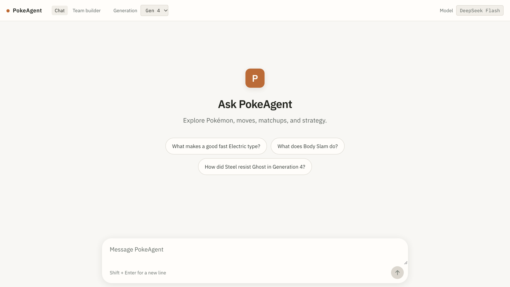
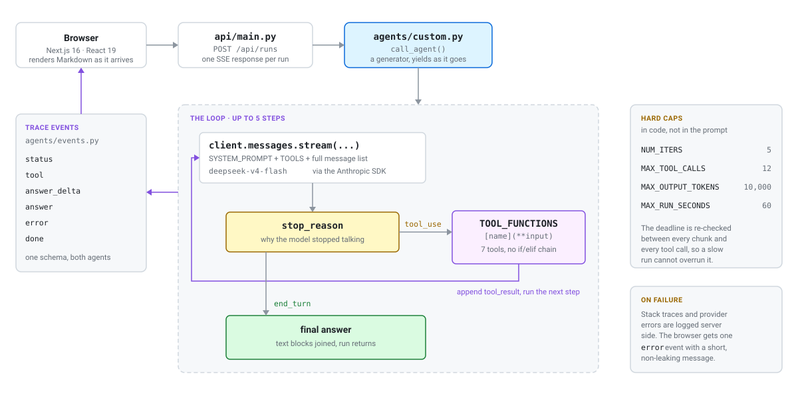
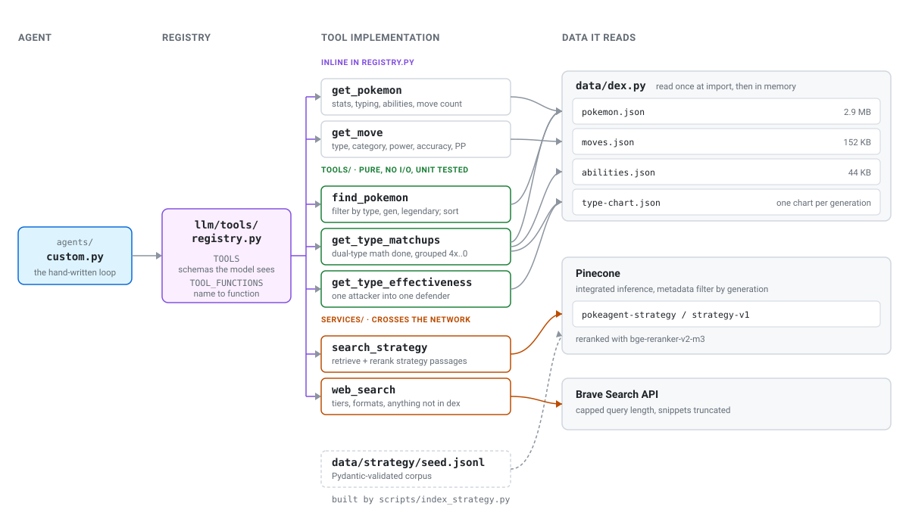
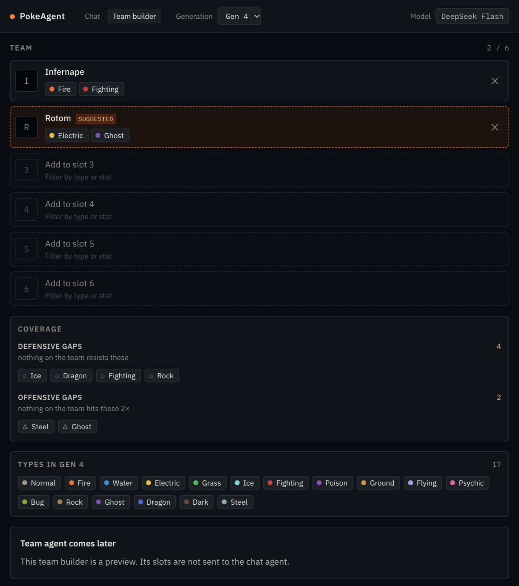

# PokeAgent

**A benchmark disguised as a Pokemon team builder.**

Two agent implementations - one hand-rolled, one built on LangChain - answer the
same open-ended Pokemon questions against the same tools, so they can be
compared on outcome quality, step count, latency, and cost. The app streams the
run as it happens: which step the agent is on, which tool it reached for, and
the answer arriving token by token.

<p align="center">
  
</p>

> **Status.** Both agents are built and streaming against all seven tools,
> under the same prompt, the same caps, and the same trace-event schema. The
> LangChain side is covered by unit tests against a fake model but has not been
> confirmed end to end against a live provider yet, and the frontend still shows
> placeholder output for it. The guard stages and the eval harness are the next
> pieces of work. Nothing here is deployed.

## Why it exists

This is a learning project. The point is to understand agent internals by
building them rather than importing them, so the parts that are usually a
library call are written by hand: the loop, the tool-schema surface, the guard
stages, and the scoring. The Pokemon domain is there because type effectiveness
has exact right answers, which makes it possible to tell a good answer from a
confident wrong one.

## How a run works

One run is a generator. It yields progress events while it goes, and the route
forwards each one down a single Server-Sent Events response.

<picture>
  <source media="(prefers-color-scheme: dark)" srcset="docs/assets/agent-loop-dark.svg">
  
</picture>

The loop itself is about a hundred lines. Each step streams one model response,
then branches on why the model stopped:

- `tool_use` - run every requested tool through the dispatch map, append the
  results as a user message, and take another step.
- `end_turn` - join the text blocks and return the answer.
- anything else, including `max_tokens` - raise, rather than guess at what the
  model meant.

Four caps bound a run, and all four live in code rather than in the prompt: five
steps, twelve tool calls, ten thousand output tokens, and sixty seconds of wall
clock. The deadline is re-checked between every streamed chunk and every tool
call, so a slow provider cannot quietly overrun it.

Failures are sanitised on the way out. Stack traces and raw provider errors go
to the server log, and the browser gets one `error` event carrying a short
message that leaks nothing.

## The two implementations

`agents/custom.py` is the loop above, written out by hand. `agents/framework.py`
hands that loop to LangChain's `create_agent` and consumes the stream it
produces: same system prompt, same tool surface, same four caps, same
`TraceEvent` output. Both satisfy the one-method protocol in
`agents/protocol.py`, so a signature drift between them becomes a type error
rather than a quiet divergence in the benchmark.

`POST /api/runs` takes an `agent` field, `"custom"` or `"langchain"`, which
defaults to `"custom"`.

What the framework took off our hands is the loop and the tool dispatch. What it
did not take is the tool schemas, which have to be adapted into its own tool
objects, or three of the four caps: two come from prebuilt middleware, the
run-wide output-token budget needs middleware written here, and the wall-clock
bound stays a deadline check in the stream loop. The LangChain module is the
longer of the two.

## The tool surface

Seven tools, defined once in `llm/tools/registry.py`. Both agents build their
tool surface from that one list, so neither can be handed a different surface
than the other - that would invalidate the comparison before it started. The
hand-rolled agent passes the schemas straight to the provider; the LangChain
agent adapts the same entries into the tool objects `create_agent` wants, rather
than redeclaring them and letting the two definitions drift.

<picture>
  <source media="(prefers-color-scheme: dark)" srcset="docs/assets/tools-and-data-dark.svg">
  
</picture>

| Tool | What it answers | Reads |
| --- | --- | --- |
| `get_pokemon` | Base stats, typing, abilities, debut generation | `pokemon.json` |
| `get_move` | Type, damage category, power, accuracy, PP | `moves.json` |
| `find_pokemon` | Category questions: everything of a type, the fastest legendary | `pokemon.json` |
| `get_type_matchups` | Effectiveness for a whole team, dual-type math already applied | `pokemon.json`, `abilities.json`, `type-chart.json` |
| `get_type_effectiveness` | One attacking type into one defending type, in one generation | `type-chart.json` |
| `search_strategy` | Roles, movesets, teammates, counters, game plans | Pinecone, reranked |
| `web_search` | Tiers, formats, anything the dex does not hold | Brave Search API |

Dex data is baked at build time from PokeAPI's CSV source and read once per
process at import, so no tool call touches the filesystem and nothing reaches
PokeAPI at runtime.

## Why the type math is a tool and not a prompt

Handing the model raw chart rows and asking it to multiply is where this gets
quietly wrong. Ferrothorn is Grass/Steel, so Fire is 2x against both halves and
the real answer is a 4x weakness. Chains involving an immunity are worse: one 0
beats any number of weaknesses, and a model that multiplies 2 x 0 and reports
"weak" is confidently wrong with no way to notice.

So `tools/` does the arithmetic and returns multipliers already grouped. The
rule for that directory is strict - pure functions, no network, no I/O, no
async, deterministic, unit tested against known-correct fixtures. Anything that
has to reach the outside world lives in `services/` instead, which exists
precisely so `tools/` never has to relax that rule.

The same math drives the coverage panel in the team builder, where a
**defensive gap** is a type nothing on the team resists and an **offensive gap**
is a type nothing on the team hits super-effectively:

<p align="center">
  
</p>

Generation is app-level state, selected in the header and passed down. It is not
cosmetic: type charts, rosters, and a Pokemon's own typing all depend on it.
Steel resisted Ghost and Dark until Generation 6, Fairy did not exist before it,
and Generation 1 had quirks of its own. Reading the wrong chart gives
confidently wrong matchups rather than an error, so nothing in the codebase
hardcodes a generation.

## Architecture

Dependencies point inward. Outer layers may import inner ones, never the
reverse.

```
api/  ->  agents/  ->  llm/tools/  ->  services/
                                   ->  tools/  ->  data/
```

```
frontend/    Next.js 16, React 19, Tailwind 4, App Router, strict TypeScript
backend/     FastAPI, Python 3.12
  api/         routes, SSE streaming, request and response models
  agents/      the two implementations, their shared protocol, the event
               schema, the system prompt
  llm/tools/   the model-facing registry: one schema per tool plus dispatch
  tools/       pure, deterministic functions over data/
  services/    anything that crosses the network
  data/        baked JSON plus the one-time fetch script
  evals/       agent runs, slow and nondeterministic, on demand
  tests/       unit tests
```

Pydantic models cover every boundary crossing, and the trace-event schema is
defined once in `agents/events.py` so both agents emit the same thing.

## Running it locally

Requires [uv](https://docs.astral.sh/uv/) and Node 22+.

```bash
cd backend && uv sync
```

```bash
cd frontend && npm install
```

Secrets go in a gitignored `.env` at the repo root. `.env.example` holds the key
names and nothing else:

```bash
cp .env.example .env
```

Every key is read server-side only. Strategy search and web search each report
that they are not configured rather than failing the run, so the agent works
with only a model key set.

Two processes. The frontend proxies `/api/*` to the backend through a rewrite in
`frontend/next.config.ts`, so the browser only ever talks to port 3000 and there
is no CORS to configure.

```bash
cd backend && uv run --env-file ../.env uvicorn api.main:app --reload --port 8000
```

```bash
cd frontend && npm run dev
```

Open http://localhost:3000. FastAPI's generated docs are at
http://localhost:8000/docs.

## Checks

```bash
cd backend && uv run pytest
```

```bash
cd backend && uv run ruff check . && uv run ruff format --check .
```

```bash
cd frontend && npm run build && npm run lint
```

## Deployment

One Vercel project, two services, configured in [vercel.json](vercel.json).
Vercel builds `frontend/` and `backend/` independently and routes `/api/*` to
the backend, everything else to the frontend. The Python entrypoint is declared
as `api.main:app` in `backend/pyproject.toml`.

Not yet deployed. See the open questions in [docs/decisions.md](docs/decisions.md)
first.

## Further reading

- [docs/decisions.md](docs/decisions.md) - what was decided, what was rejected,
  and why
- [docs/planned.md](docs/planned.md) - the pieces that are designed but not built
- [docs/strategy-retrieval-roadmap.md](docs/strategy-retrieval-roadmap.md) - how
  the strategy corpus is meant to grow
- [CLAUDE.md](CLAUDE.md) - the working agreement and architecture rules

Dex data is generated from [PokeAPI](https://pokeapi.co/) CSV source data,
BSD-3-Clause. Pokemon is a trademark of Nintendo, Creatures Inc. and GAME FREAK
Inc. This is an unaffiliated, non-commercial learning project.
